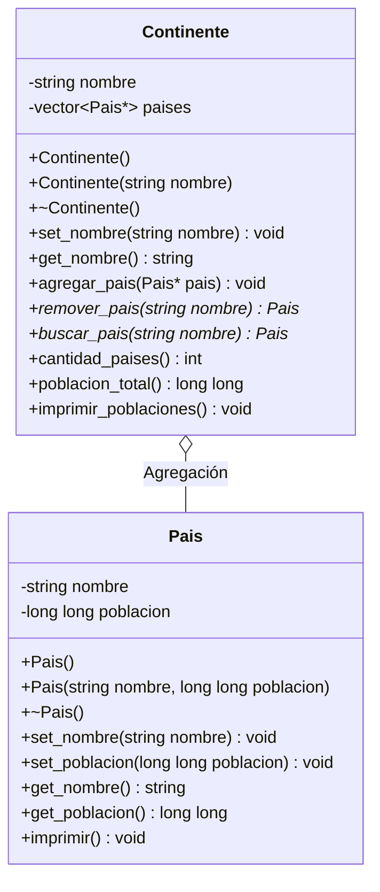
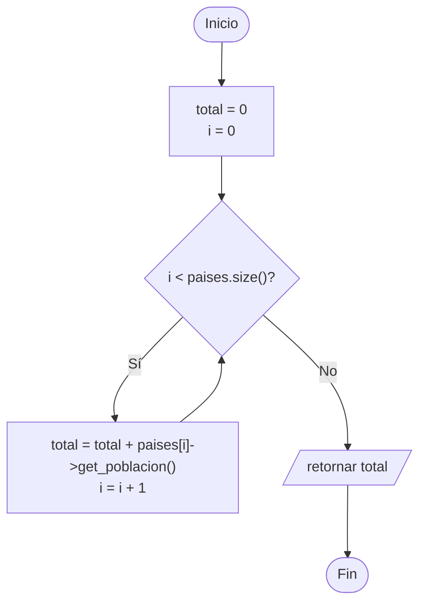

# A1 – Continente y País (agregación)

> Ejercicio 1 de la sesión 11A: *definir una clase `Continente` y una clase `Pais` que permita crear un objeto `Continente` que contenga un conjunto de países. Implementar métodos para remover países del continente e imprimir sus poblaciones.*

> **Ojo:** este ejercicio todavía **no usa herencia**. Es un repaso de la **agregación** de la semana 11 y sirve de punto de partida: la herencia entra desde A2.

## Diagrama de clase

## La relación

| | Agregación |
|---|---|
| Cómo se representa | Un `vector<Pais*>` dentro de `Continente` |
| Quién crea los objetos | El `main`, con `new` |
| Quién los destruye | El `main`, con `delete` |
| Si desaparece el `Continente` | Los países siguen existiendo |
| Remover un país | Sale del vector con `erase`; el objeto no se borra |
| Símbolo UML | Rombo vacío ◇ del lado del continente |

## Preguntas de la sesión

| Pregunta | Respuesta |
|---|---|
| ¿Por qué el vector guarda punteros y no objetos? | Porque los países existen por sí solos; el continente solo los agrupa |
| ¿Qué devuelve `remover_pais()`? | El puntero al país que salió de la lista, para que el `main` siga teniéndolo |
| ¿Qué pasa si el destructor del continente hace `delete` de cada país? | Deja de ser agregación y, si el `main` también los libera, se borran dos veces |
| ¿Cómo se comprueba en la consola? | Por el orden de los mensajes de los destructores al terminar el programa |

## Diagrama de flujo – `poblacion_total()`

## Tareas

- [ ] **1. Clase `Pais`.** Crea `Pais.h` y `Pais.cpp` con los atributos privados `nombre` y `poblacion`.
- [ ] **2. Constructores y destructor de `Pais`.** Uno vacío y uno con parámetros. El destructor imprime un mensaje con el nombre. *Pista: usa `this->` dentro del constructor.*
- [ ] **3. Setters, getters e `imprimir()`** de `Pais`.
- [ ] **4. Clase `Continente`.** Atributos privados `nombre` y `vector<Pais*> paises`. *Pista: incluye `<vector>` en el `.h`.*
- [ ] **5. `agregar_pais(Pais*)`.** Guarda el puntero con `push_back`. No crea nada con `new`.
- [ ] **6. `remover_pais(string)`.** Busca por nombre, saca el elemento con `erase` y **devuelve el puntero**. *Pista: no uses `delete` aquí.*
- [ ] **7. `imprimir_poblaciones()`.** Recorre el vector con `->` e imprime cada país; al final muestra la población total.
- [ ] **8. `poblacion_total()`.** Acumula la población de todos los países del vector.
- [ ] **9. `main`.** Crea cuatro países con `new`, agrégalos al continente, imprime, remueve uno, vuelve a imprimir y libera todos los países con `delete` al final.
- [ ] **10. Comprobación.** Imprime el país removido después de sacarlo de la lista y responde: ¿sigue existiendo?
