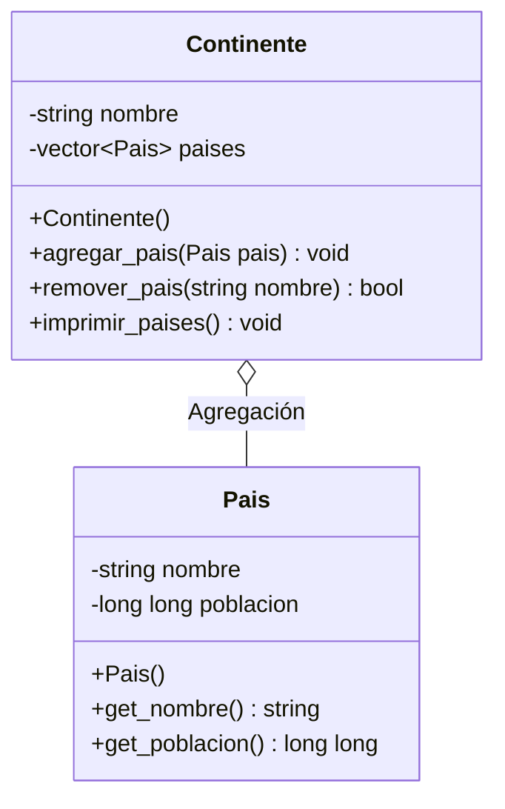
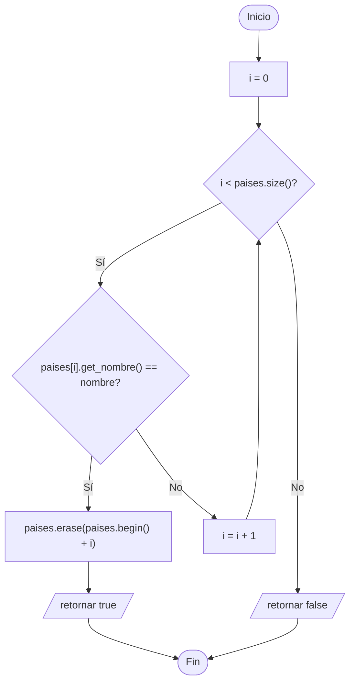

# A1 – Continente y País (agregación)

> Ejercicio 1 de la sesión 11A: *definir una clase `Continente` y una clase `Pais` que permita crear un objeto `Continente` que contenga un conjunto de países. Implementar métodos para remover países del continente e imprimir sus poblaciones.*

> **Ojo:** este ejercicio todavía **no usa herencia**. Es un repaso de la semana 11 y sirve de punto de partida: la herencia entra desde A2.

## Diagrama de clase

Es el diagrama de la diapositiva, tal cual:

Dos precisiones sobre la diapositiva:

- El diagrama dice `int nombre` en `Pais`: es un error de la PPT, el nombre es `string`.
- El diagrama no muestra tipos de retorno ni un constructor con parámetros. Aquí `remover_pais()` devuelve `bool` (si lo encontró o no) y `Pais` tiene además un constructor con nombre y población, porque sin él no hay forma de cargar los datos.

## La relación

El atributo es `vector<Pais>`: **objetos por valor**, no punteros.

| | `vector<Pais>` (lo que pide la PPT) |
|---|---|
| Qué guarda el vector | Copias de los países |
| Cómo se accede a un elemento | Con `.` (`paises[i].get_nombre()`), no con `->` |
| Quién crea los objetos | El `main` los construye y `agregar_pais()` los **copia** |
| Quién los destruye | Nadie: se destruyen solos al destruirse el continente |
| Si desaparece el `Continente` | Los países desaparecen con él |
| Remover un país | `erase` sobre el vector; la copia se destruye ahí mismo |
| ¿Hay `new` o `delete`? | **No** |

### Una advertencia para la clase

La diapositiva etiqueta la relación como **agregación** y dibuja el rombo vacío ◇, pero implementa `vector<Pais>` por valor. Según el cuadro de la semana 11, por valor es **composición** (rombo relleno ◆): la parte nace y muere con el todo y no se puede compartir.

Es una buena pregunta para lanzarles en clase: *¿el diagrama de la diapositiva es coherente?* Para que fuera agregación de verdad el atributo tendría que ser `vector<Pais*>`, con los países creados y liberados por el `main`.

| | Agregación | Composición |
|---|---|---|
| Atributo | `vector<Pais*>` | `vector<Pais>` |
| Acceso | `->` | `.` |
| ¿Se comparte la parte? | Sí | No |
| ¿Quién libera? | Quien hizo el `new` | Nadie: muere con el todo |
| Símbolo UML | ◇ | ◆ |

## Preguntas de la sesión

| Pregunta | Respuesta |
|---|---|
| ¿Por qué se accede con `.` y no con `->`? | Porque el vector guarda objetos, no punteros |
| ¿Qué pasa con el país al hacer `erase`? | Se destruye su copia dentro del vector; no hay `delete` que hacer |
| ¿Qué le pasa al objeto original que se pasó a `agregar_pais()`? | Nada: el continente se quedó con una **copia** |
| ¿Cómo se avisa que un país no existe? | Con el `bool` que devuelve `remover_pais()` |
| ¿Por qué no se compara con `pais != Pais()`? | Porque `Pais` no define `operator==`; la búsqueda se hace por nombre |

## Diagrama de flujo – `remover_pais(nombre)`

## Tareas

- [ ] **1. Clase `Pais`.** Crea `Pais.h` y `Pais.cpp` con los atributos privados `nombre` y `poblacion`.
- [ ] **2. Constructores de `Pais`.** Uno vacío y uno con parámetros. *Pista: usa `this->` dentro del constructor.*
- [ ] **3. `get_nombre()` y `get_poblacion()`**, los dos `const`.
- [ ] **4. Clase `Continente`.** Atributos privados `nombre` y `vector<Pais> paises`. *Pista: incluye `<vector>` en el `.h`.*
- [ ] **5. `agregar_pais(const Pais&)`.** Copia el país al vector con `push_back`. *Pista: el parámetro va por referencia constante para no copiarlo dos veces.*
- [ ] **6. `remover_pais(string)`.** Busca por nombre, saca el elemento con `erase` y devuelve `true`; si no lo encuentra, `false`.
- [ ] **7. `imprimir_paises()`.** Recorre el vector con `.` e imprime cada país; al final muestra la población total.
- [ ] **8. `main`.** Crea el continente, agrégale cuatro países, imprime, remueve uno y vuelve a imprimir.
- [ ] **9. Comprobación.** Intenta remover un país que no está y muestra el mensaje correspondiente.
- [ ] **10. Para pensar.** El diagrama dice agregación pero el atributo es por valor. ¿Qué habría que cambiar para que fuera agregación de verdad?
