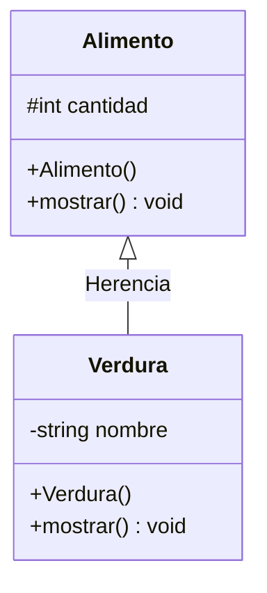

# A2 – Alimento y Verdura (herencia y métodos virtuales)

> Ejercicio 2 de la sesión 11A: *definir una clase `Alimento` y una clase derivada `Verdura` que permita obtener la cantidad de objetos `Verdura` compradas. Crear un objeto `Alimento`, un objeto `Verdura` y una copia de `Verdura` a `Alimento`. Repetir el procedimiento usando punteros y observar el comportamiento. Observe el efecto de métodos virtuales con herencia.*

Primer ejercicio de **herencia** del laboratorio: *una verdura **es un** alimento*.

## Diagrama de clase

Dos precisiones:

- Ambas clases tienen un constructor con parámetros además del vacío, porque sin eso no hay forma de cargar los datos.
- `cantidad` va como `protected` para que `Verdura::mostrar()` pueda usarlo.

## El punto del ejercicio

`mostrar()` **no es virtual**, igual que en el diagrama. Eso es justamente lo que hay que observar:

| Caso | Qué se escribe | Qué imprime |
|---|---|---|
| Objeto de la subclase | `verdura.mostrar()` | `[Verdura] Brocoli \| cantidad: 5` |
| **Copia a la superclase** | `Alimento copia = verdura;` | `[Alimento] cantidad: 5` |
| **Puntero a la superclase** | `Alimento* p = new Verdura(...)` | `[Alimento] cantidad: 3` |
| Puntero a la subclase | `Verdura* p = new Verdura(...)` | `[Verdura] Espinaca \| cantidad: 7` |

Los dos casos del medio pierden la parte `Verdura`, pero por motivos distintos:

- **La copia** se queda sin el `nombre`: al copiar a un `Alimento` solo cabe la parte `Alimento`. El objeto dejó de ser una verdura.
- **El puntero** sí apunta a una `Verdura` completa, pero como `mostrar()` no es virtual, el compilador decide a qué función llamar mirando el **tipo del puntero** (`Alimento*`), no el objeto real.

Ahí entra la última línea del enunciado: al agregar `virtual` a `mostrar()` en `Alimento`, el tercer caso pasa a imprimir `[Verdura]`, porque la decisión se toma en tiempo de ejecución. La copia, en cambio, **sigue imprimiendo `[Alimento]`**: el `virtual` no la arregla, porque ahí el objeto ya no es una verdura.

La conclusión: el polimorfismo necesita `virtual` **y** punteros (o referencias). Falta cualquiera de los dos y no funciona.

## Preguntas de la sesión

| Pregunta | Respuesta |
|---|---|
| ¿Por qué `cantidad` es `protected` y no `private`? | Para que `Verdura` pueda usarlo directamente; con `private` solo se llegaría por un getter |
| ¿Por qué la copia pierde el nombre? | Porque un `Alimento` no tiene dónde guardarlo: solo se copia la parte heredada |
| ¿Por qué el puntero `Alimento*` llama a `Alimento::mostrar()`? | Porque `mostrar()` no es virtual: se resuelve en tiempo de compilación |
| Al agregar `virtual`, ¿se arreglan los dos casos? | No: solo el del puntero. La copia sigue siendo un `Alimento` |
| ¿Qué pasa con `delete pAlimento` si `Alimento` no tiene destructor virtual? | No se ejecutaría el destructor de `Verdura`. Aquí no se nota porque ninguna clase reserva memoria, pero es el siguiente paso del tema |

## Tareas

- [ ] **1. Clase `Alimento`.** Atributo `protected` `cantidad`, constructor vacío y constructor con parámetro.
- [ ] **2. `mostrar()` de `Alimento`.** Imprime la cantidad. **Sin** `virtual` por ahora.
- [ ] **3. Clase `Verdura : public Alimento`.** Agrega `nombre`. *Pista: incluye `Alimento.h` en `Verdura.h`.*
- [ ] **4. Constructor con lista de inicializadores.** `Verdura(...) : Alimento(cantidad) { ... }`.
- [ ] **5. `mostrar()` de `Verdura`.** Imprime nombre y cantidad.
- [ ] **6. `main`.** Los cuatro casos: objeto `Alimento`, objeto `Verdura`, copia `Alimento copia = verdura;` y los dos punteros.
- [ ] **7. El experimento.** Agrega `virtual` a `mostrar()` en `Alimento`, vuelve a ejecutar y anota qué línea cambió y cuál no.
- [ ] **8. Comprobación.** Responde por escrito: ¿por qué el `virtual` arregla el caso del puntero pero no el de la copia?
