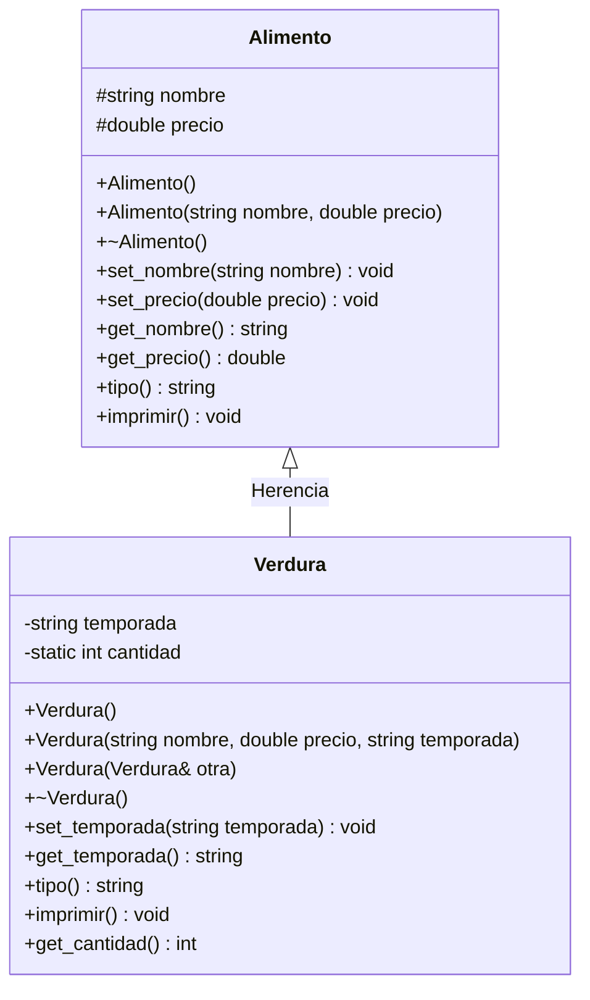

# A2 – Alimento y Verdura (herencia, static y métodos virtuales)

> Ejercicio 2 de la sesión 11A: *definir una clase `Alimento` y una clase derivada `Verdura` que permita obtener la cantidad de objetos `Verdura` compradas. Crear un objeto `Alimento`, un objeto `Verdura` y una copia de `Verdura` a `Alimento`. Repetir el procedimiento usando punteros y observar el comportamiento. Observe el efecto de métodos virtuales con herencia.*

Este es el primer ejercicio de **herencia** del laboratorio: *una verdura **es un** alimento*.

## Diagrama de clase



`tipo()` e `imprimir()` son **virtuales** en `Alimento` y están **sobrescritas** (`override`) en `Verdura`. El destructor de `Alimento` también es virtual.

## Lo que hay que observar

| Caso | Qué se escribe | Qué imprime | Por qué |
|---|---|---|---|
| Objeto de la subclase | `Verdura brocoli(...)` | `[Verdura]` | El objeto es una verdura completa |
| **Copia a la superclase** | `Alimento copia = brocoli;` | `[Alimento]` | Solo se copia la parte `Alimento`; se pierde `temporada` y el `override` |
| **Puntero a la superclase** | `Alimento* p = new Verdura(...)` | `[Verdura]` | El método es `virtual`: se resuelve en tiempo de ejecución |
| `delete p` | — | `~Verdura` y luego `~Alimento` | Porque el destructor de `Alimento` es `virtual` |

La conclusión del ejercicio: **el polimorfismo funciona con punteros (o referencias), no con copias por valor.**

## El atributo `static`

```cpp
class Verdura : public Alimento {
    static int cantidad;        // declaracion dentro de la clase
};
```
```cpp
int Verdura::cantidad = 0;      // definicion en el .cpp, una sola vez
```

- Es **uno solo para toda la clase**, no uno por objeto.
- Se incrementa en **cada** constructor (incluido el constructor copia) y se decrementa en el destructor.
- Se consulta sin necesidad de un objeto: `Verdura::get_cantidad()`.
- `Alimento copia = brocoli;` **no** cambia el contador: esa copia no es una `Verdura`.

## Preguntas de la sesión

| Pregunta | Respuesta |
|---|---|
| ¿Por qué `nombre` y `precio` son `protected` y no `private`? | Para que `Verdura` pueda usarlos directamente; con `private` solo se llegaría por los getters |
| ¿Por qué `Verdura` tiene constructor copia? | Para que el contador no se descuadre al copiar una verdura |
| ¿Qué pasa si el destructor de `Alimento` no es `virtual`? | Al hacer `delete` sobre un `Alimento*` nunca se ejecuta `~Verdura` |
| ¿Se puede llamar a `get_temporada()` desde un `Alimento*`? | No: la superclase no conoce los miembros añadidos por la subclase |

## Tareas

- [ ] **1. Clase `Alimento`.** Atributos `protected` `nombre` y `precio`; constructores, setters y getters.
- [ ] **2. Destructor virtual** de `Alimento`, que imprima un mensaje.
- [ ] **3. Métodos `virtual`** `tipo()` e `imprimir()` en `Alimento`.
- [ ] **4. Clase `Verdura : public Alimento`.** Agrega `temporada`. *Pista: incluye `Alimento.h` en `Verdura.h`.*
- [ ] **5. Constructor con lista de inicializadores.** `Verdura(...) : Alimento(nombre, precio) { ... }`.
- [ ] **6. Atributo `static int cantidad`.** Decláralo en el `.h` y defínelo en el `.cpp`; incremento en los constructores, decremento en el destructor.
- [ ] **7. `override` de `tipo()` e `imprimir()`** en `Verdura`.
- [ ] **8. `static int get_cantidad()`.** Devuelve el contador.
- [ ] **9. `main` – caso por valor.** Crea un `Alimento`, una `Verdura` y una copia `Alimento copia = verdura;`. Imprime las tres y el contador.
- [ ] **10. `main` – caso con punteros.** Crea `Alimento* p = new Verdura(...)`, imprime, muestra el contador, haz `delete` y vuelve a mostrarlo.
- [ ] **11. Comprobación.** Responde por escrito: ¿por qué la copia imprime `[Alimento]` y el puntero imprime `[Verdura]`?
