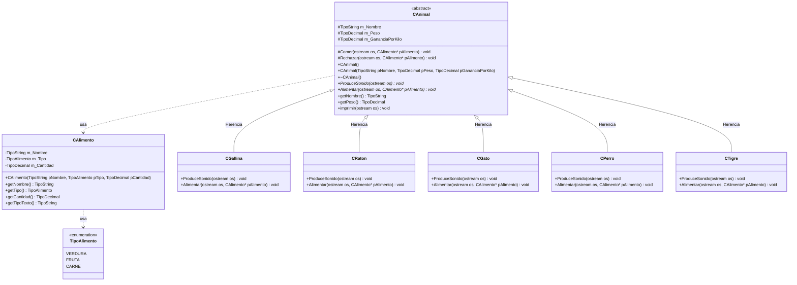
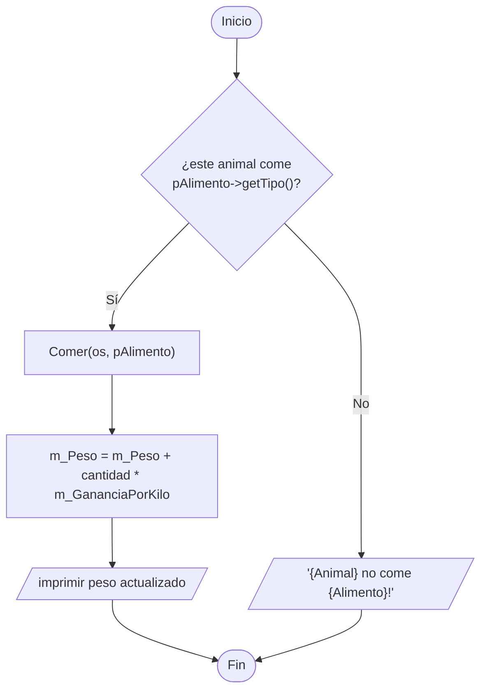

# A3 – Animales (clase abstracta y funciones virtuales puras)

> Ejercicio 3 de la sesión 11A: *tomando como base el código y el diagrama de clase, aplique los conceptos de herencia para modelar los escenarios descritos.* **OJO: USE FUNCIONES VIRTUALES PURAS.**

> El proyecto se arma desde cero con las firmas que aparecen en la teoría de la sesión:
> ```cpp
> virtual void ProduceSonido(ostream &os) = 0;
> virtual void Alimentar(ostream &os, CAlimento* pAlimento) = 0;
> ```

## Requerimientos

**Sonido de cada animal**

| Animal | Sonido | Gana por kilo |
|---|---|---|
| Gallina | `Cluck` | 0.35 |
| Ratón | `Squeak` | 0.10 |
| Gato | `Miau` | 0.30 |
| Perro | `¡Guau!` | 0.40 |
| Tigre | `¡¡¡ROAR!!!` | 1.00 |

**Qué come cada animal**

| Animal | Verdura | Fruta | Carne |
|---|---|---|---|
| Gallina | sí | sí | sí |
| Ratón | sí | sí | no |
| Gato | sí | no | sí |
| Perro | no | no | sí |
| Tigre | no | no | sí |

- Si se le ofrece un alimento que no come, se imprime `"{Animal} no come {Alimento}!"` y **no** sube de peso.
- Si lo come, el peso aumenta `cantidad * ganancia por kilo`.

## Diagrama de clase



## Función virtual pura y clase abstracta

```cpp
class CAnimal {
public:
    virtual void ProduceSonido(std::ostream &os) = 0;                       // sin cuerpo
    virtual void Alimentar(std::ostream &os, CAlimento* pAlimento) = 0;     // sin cuerpo
};
```

- El `= 0` (**especificador puro**) dice que la implementación **la pone la subclase**.
- Una clase con al menos una función virtual pura es **abstracta**: `CAnimal animal;` no compila.
- Para usarla hay que derivar una subclase e implementar **todas** sus funciones virtuales puras.
- El destructor sí tiene cuerpo y es `virtual`, porque los objetos se manejan con punteros `CAnimal*`.

## Lo que gana el diseño

Un solo vector guarda animales de clases distintas y el `main` los trata igual:

```cpp
vector<CAnimal*> animales;
animales.push_back(new CGallina(2.00));
animales.push_back(new CTigre(150.00));

for (int i = 0; i < (int) animales.size(); i++) {
    animales[i]->ProduceSonido(cout);        // cada uno responde con su propio sonido
    animales[i]->Alimentar(cout, plato);     // cada uno aplica su propia regla
}
```

El `main` **no pregunta de qué animal se trata**: no hay `if` por tipo. Esa decisión vive dentro de cada subclase.

`Comer()` y `Rechazar()` están en `CAnimal` como `protected`: son el comportamiento común, y cada subclase solo decide **cuándo** llamar a cada uno.

## Por qué los métodos reciben `ostream &os`

Las dos funciones virtuales puras no escriben en la consola: reciben **dónde** escribir.

```cpp
virtual void ProduceSonido(std::ostream &os) = 0;
virtual void Alimentar(std::ostream &os, CAlimento* pAlimento) = 0;
```

`std::ostream` es el tipo de los flujos de salida. `std::cout` es uno, pero también lo son un archivo y un string en memoria. Al recibir el flujo como parámetro, la clase deja de estar amarrada a la pantalla:

```cpp
CGallina gallina(2.0);

gallina.ProduceSonido(cout);           // a la consola

ofstream archivo("salida.txt");
gallina.ProduceSonido(archivo);        // al archivo salida.txt

ostringstream s;
gallina.ProduceSonido(s);              // a un string en memoria
cout << "lo que escribio: " << s.str() << endl;
```

Los tres usan **la misma función**, sin cambiar una línea de `CGallina`.

| Destino | Tipo | Para qué sirve |
|---|---|---|
| `cout` | `ostream` | lo normal, ver la salida en pantalla |
| `ofstream` | archivo | dejar un registro de la simulación |
| `ostringstream` | string en memoria | capturar la salida y **comprobar** que dice lo correcto |

El tercero es el más útil para corregir: permite verificar en código que la gallina realmente escribió `"Cluck"`, sin que nadie tenga que leer la consola.

Dos detalles de sintaxis:

- **El `&` es obligatorio.** Los flujos no se pueden copiar: `std::ostream os` sin el `&` no compila.
- **No puede ser `const`**, porque escribir en un flujo lo modifica.
- Para usar los otros dos destinos hay que incluir `<fstream>` (archivos) y `<sstream>` (strings).

Si en vez de esto cada método usara `cout` directamente, la clase funcionaría igual, pero solo podría imprimir en pantalla para siempre.

## Preguntas de la sesión

| Pregunta | Respuesta |
|---|---|
| ¿Por qué `CAnimal` no se puede instanciar? | Porque tiene funciones virtuales puras: su definición está incompleta |
| ¿Qué pasa si una subclase no implementa `Alimentar()`? | Esa subclase sigue siendo abstracta y tampoco se puede instanciar |
| ¿Por qué `ProduceSonido` recibe un `ostream&`? | Para poder escribir en `cout`, en un archivo o en un `ostringstream` sin cambiar la clase |
| ¿Por qué el destructor de `CAnimal` es `virtual`? | Para que `delete` sobre un `CAnimal*` ejecute el destructor de la subclase |
| ¿Dónde está el `if` que decide qué come cada animal? | Dentro del `Alimentar()` de cada subclase, no en el `main` |

## Diagrama de flujo – `Alimentar()` de una subclase



## Tareas

- [ ] **1. `Tipos.h`.** Alias `TipoEntero`, `TipoDecimal`, `TipoString` y el `enum TipoAlimento { VERDURA, FRUTA, CARNE }`.
- [ ] **2. Clase `CAlimento`.** Nombre, tipo y cantidad en kilos, con sus getters y `getTipoTexto()`.
- [ ] **3. Clase abstracta `CAnimal`.** Atributos `protected` `m_Nombre`, `m_Peso`, `m_GananciaPorKilo`.
- [ ] **4. Funciones virtuales puras.** Declara `ProduceSonido` y `Alimentar` con `= 0`. *Pista: incluye `<ostream>`.*
- [ ] **5. Destructor virtual** de `CAnimal`, y los métodos `protected` `Comer()` y `Rechazar()`.
- [ ] **6. Comprobación.** Escribe `CAnimal animal("x", 1.0, 0.1);` en el `main`, compila y lee el error. Déjalo comentado.
- [ ] **7. Las cinco subclases.** `CGallina`, `CRaton`, `CGato`, `CPerro` y `CTigre`, cada una con su constructor que invoca al de `CAnimal` en la lista de inicializadores.
- [ ] **8. `ProduceSonido()` de cada subclase.** Con el sonido de la tabla.
- [ ] **9. `Alimentar()` de cada subclase.** Con la regla de alimentos de la tabla, llamando a `Comer()` o a `Rechazar()`.
- [ ] **10. `main`.** Un `vector<CAnimal*>` con los cinco animales, un `vector<CAlimento*>` con tres platos, y dos bucles: uno de sonidos y otro de alimentación.
- [ ] **11. Peso final y liberación.** Imprime el peso de cada animal y haz `delete` de todos los punteros.
