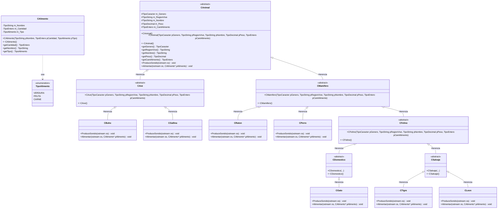
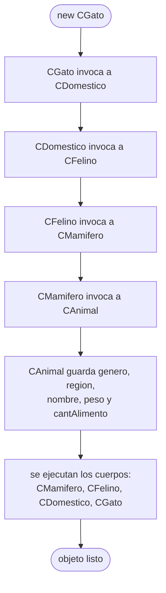

# A4 – Animales por niveles (la jerarquía completa del diagrama)

> Es el **mismo ejercicio 3**, armado con la jerarquía completa del diagrama de clases, en vez de la versión plana de [A3](../A3_Animales/README.md).

> A3 cuelga los cinco animales directamente de `CAnimal`. Acá aparecen las clases intermedias —`CAve`, `CMamifero`, `CFelino`, `CDomestico`, `CSalvaje`— y la cadena llega a cinco niveles.

## La jerarquía

```
CAnimal              abstracta   <- aqui se declaran las virtuales puras
├── CAve             abstracta
│   ├── CBuho        concreta
│   └── CGallina     concreta
└── CMamifero        abstracta
    ├── CRaton       concreta
    ├── CPerro       concreta
    └── CFelino      abstracta
        ├── CDomestico   abstracta
        │   └── CGato    concreta
        └── CSalvaje     abstracta
            ├── CTigre   concreta
            └── CLeon    concreta
```

Sale de la teoría de la sesión: *"Un búho y una gallina son aves. Un ratón y un perro son mamíferos. Un gato es un felino doméstico y a su vez es un mamífero. Un tigre y un león son felinos salvajes y a su vez son mamíferos. Todos a su vez son animales."*

## Diagrama de clase



Las operaciones en **cursiva** dentro de `CAnimal` son las virtuales puras.

## Lo abstracto se hereda

`CAnimal` declara `ProduceSonido()` y `Alimentar()` con `= 0`. Ninguna clase intermedia las implementa, así que **todas arrastran el hueco**:

| Clase | ¿Declara virtuales puras propias? | ¿Las implementa? | ¿Se puede instanciar? |
|---|---|---|---|
| `CAnimal` | sí, las dos | no | **no** |
| `CAve`, `CMamifero` | no | no | **no** |
| `CFelino`, `CDomestico`, `CSalvaje` | no | no | **no** |
| `CGallina`, `CRaton`, `CPerro`, `CGato`, `CTigre` | no | **sí** | sí |

`CMamifero` no tiene ni una función virtual pura escrita en su `.h`, y aun así es abstracta: hereda las dos de `CAnimal` sin llenarlas. Esa es la parte que más cuesta ver, y es el punto fuerte del ejercicio.

Compruébalo descomentando la línea del `main`:

```cpp
// CAnimal a;   CAve b;   CMamifero c;   CFelino d;   CSalvaje e;
```

El compilador rechaza las cinco, con el mismo mensaje: *"cannot declare variable to be of abstract type"*.

## La cadena de constructores

Crear un `CGato` dispara cuatro constructores en orden, de arriba hacia abajo:

```
CAnimal  ->  CMamifero  ->  CFelino  ->  CDomestico  ->  CGato
```

Cada nivel invoca al de arriba en su lista de inicializadores, y solo el último guarda los datos:

```cpp
CDomestico::CDomestico(TipoCaracter pGenero, const TipoString& pRegionVive,
                       const TipoString& pNombre, TipoDecimal pPeso, TipoEntero pCantAlimento)
        : CFelino(pGenero, pRegionVive, pNombre, pPeso, pCantAlimento) {}
```

Las clases intermedias no hacen nada más que pasar los parámetros hacia arriba. Es repetitivo a propósito: muestra que la construcción recorre toda la cadena aunque los niveles del medio no agreguen nada.

Y al destruir pasa lo contrario: `~CGato()`, `~CDomestico()`, `~CFelino()`, `~CMamifero()`, `~CAnimal()`, de abajo hacia arriba. Por eso `~CAnimal()` es `virtual`: sin eso, borrar un gato por un `CAnimal*` no ejecutaría ninguno de los cuatro de abajo.

## Preguntas de la sesión

| Pregunta | Respuesta |
|---|---|
| ¿Por qué `CMamifero` es abstracta si no declara ninguna función pura? | Porque hereda dos de `CAnimal` y no las implementa |
| ¿Qué gana el diseño con `CFelino` y `CSalvaje` si están vacías? | Expresan la clasificación del enunciado y dejan el lugar listo para lo común a los felinos |
| ¿Cuántos constructores se ejecutan al crear un `CTigre`? | Cuatro: `CAnimal`, `CMamifero`, `CFelino`, `CSalvaje`, y luego el suyo |
| ¿En qué orden corren los destructores? | Al revés que los constructores: del más derivado al más base |
| ¿`CGato` es un `CAnimal`? | Sí. También es `CMamifero`, `CFelino` y `CDomestico`. Un objeto pertenece a todos los tipos de su cadena |

## Diagrama de flujo – construcción de un `CGato`



## Pendiente

`CBuho` y `CLeon` están en el diagrama pero **no en el código**: el enunciado no dice qué sonido hacen, cuánto peso ganan por kilo ni qué comen. Solo detalla gallina, ratón, perro, gato y tigre. Faltan esos tres datos por animal para completarlas.

## Tareas

- [ ] **1. `Tipos.h`.** Los cuatro alias del diagrama: `TipoEntero`, `TipoCaracter`, `TipoDecimal`, `TipoString`.
- [ ] **2. `CAlimento`.** Nombre, cantidad y tipo, con sus tres getters.
- [ ] **3. `CAnimal`.** Los cinco atributos `protected` del diagrama y sus cinco getters.
- [ ] **4. Las dos virtuales puras** y el destructor virtual.
- [ ] **5. `CAve` y `CMamifero`.** Solo constructor y destructor; siguen abstractas.
- [ ] **6. Comprobación.** Escribe `CMamifero m(...)` en el `main`, compila y lee el error. Déjalo comentado.
- [ ] **7. `CFelino`, `CDomestico` y `CSalvaje`.** Tercer y cuarto nivel, igual de vacías.
- [ ] **8. Las hojas.** `CGallina` y `CRaton` primero, que son las de cadena más corta.
- [ ] **9. `CGato` y `CTigre`.** Las de cadena larga: cinco constructores encadenados.
- [ ] **10. `main`.** Un `vector<CAnimal*>` con los cinco, el bucle de sonidos y el de alimentación.
- [ ] **11. Para pensar.** Si todos los felinos compartieran un método `Acechar()`, ¿en qué clase lo pondrías y por qué?
