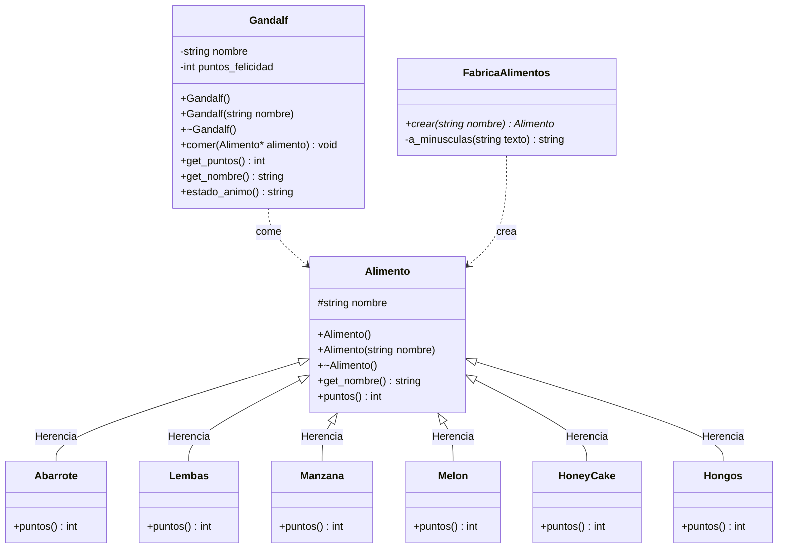
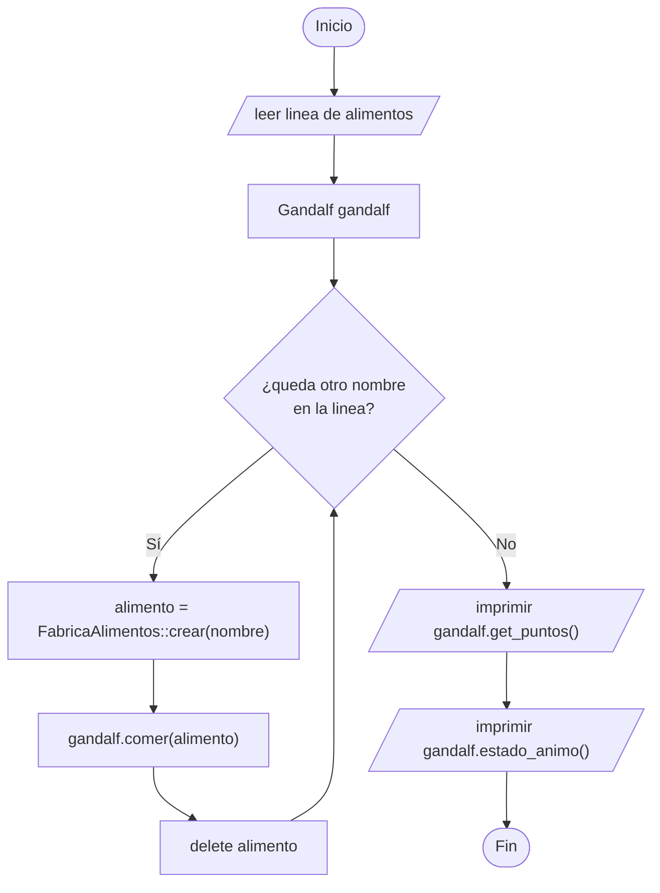
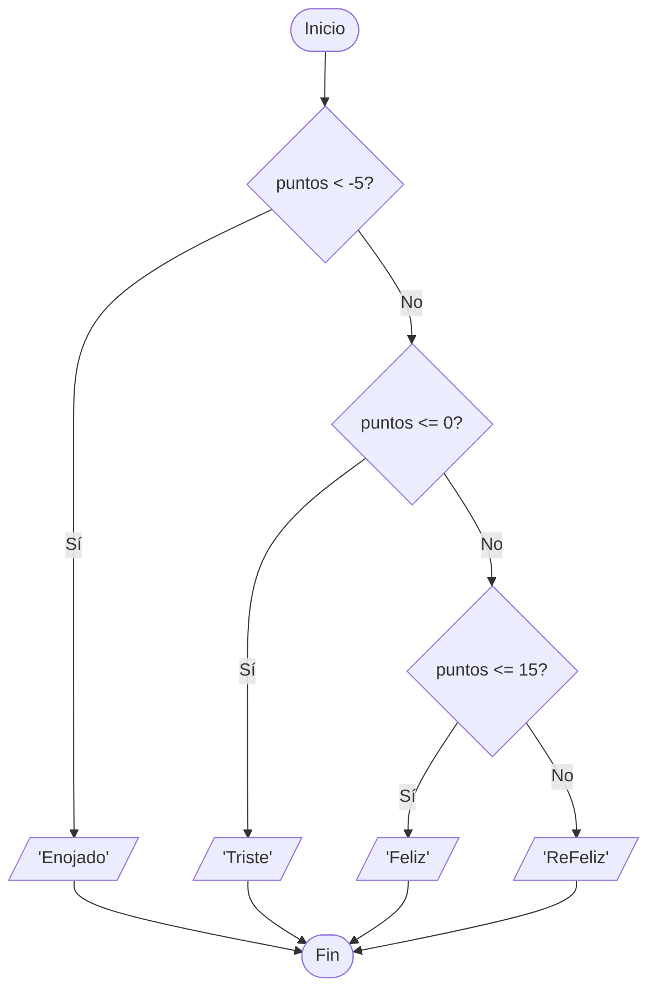

# B1 – Gandalf y su estado de ánimo (sesión 11B)

> Ejercicio 1 de la sesión 11B: *Gandalf el Gris pierde su capacidad de luchar cuando tiene hambre. Modele una aplicación que calcule los puntos de felicidad que Gandalf tiene después de comer toda la comida que se pasa en la entrada. Imprima en la primera línea los puntos totales y en la segunda el nombre del estado de ánimo.*

## Requerimientos de la PPT

**Puntos de felicidad por alimento**

| Alimento | Puntos |
|---|---|
| Abarrote | +2 |
| Lembas | +3 |
| Manzana | +1 |
| Melón | +1 |
| HoneyCake | +5 |
| Hongos | −10 |
| **Todo lo demás** | **−1** |

**Estados de ánimo**

| Estado | Rango de puntos |
|---|---|
| Enojado | por debajo de −5 |
| Triste | de −5 a 0 |
| Feliz | de 1 a 15 |
| ReFeliz | más de 15 |

## Diagrama de clase



## La idea del diseño

El truco del ejercicio es la fila **"todo lo demás: −1 punto"**. En vez de resolverla con un `else` final, se resuelve con herencia:

- `Alimento` es la **superclase** y su `puntos()` devuelve `-1`: *es* el caso "todo lo demás".
- Cada alimento conocido es una **subclase** que **sobrescribe** `puntos()` con su propio valor.
- `FabricaAlimentos::crear()` traduce el texto de la entrada al objeto correspondiente; si el nombre no está en la lista devuelve un `Alimento` genérico.

Así `Gandalf` queda limpio: no sabe qué alimento recibió ni cuántos tipos existen.

```cpp
void Gandalf::comer(Alimento* alimento) {
    if (alimento != nullptr) {
        puntos_felicidad += alimento->puntos();   // la subclase responde
    }
}
```

Para agregar un alimento nuevo (por ejemplo `Pipa`) solo hay que crear su clase y una línea en la fábrica: **`Gandalf` no se toca**.

## Preguntas de la sesión

| Pregunta | Respuesta |
|---|---|
| ¿Por qué `puntos()` es `virtual`? | Para que, desde un `Alimento*`, se ejecute la versión de la subclase |
| ¿Qué pasa si se quita el `virtual`? | Todo devuelve −1: se llamaría siempre a la versión de la superclase |
| ¿Por qué `Alimento` no es abstracta aquí? | Porque sí tiene un comportamiento propio útil: el caso "todo lo demás" |
| ¿Por qué el destructor de `Alimento` es `virtual`? | Porque los objetos se liberan a través de un `Alimento*` |
| ¿Dónde se decide el estado de ánimo? | En `Gandalf::estado_animo()`, con los rangos de la tabla; los alimentos no lo saben |

## Diagrama de flujo – programa principal



## Diagrama de flujo – `estado_animo()`



## Ejecución

El programa pide una línea con los alimentos separados por espacios. Si se presiona Enter sin escribir nada usa un ejemplo.

```
Lembas HoneyCake Manzana Hongos Abarrote Piedra Melon
```

```
--- Resultado ---
1
Feliz
```

Las dos últimas líneas son la salida que pide la PPT: puntos totales y estado de ánimo.

## Casos de prueba

| Entrada | Puntos | Estado |
|---|---|---|
| `Lembas HoneyCake Manzana Hongos Abarrote Piedra Melon` | 1 | Feliz |
| `Hongos Hongos` | −20 | Enojado |
| `HoneyCake HoneyCake HoneyCake HoneyCake` | 20 | ReFeliz |
| `Manzana Piedra` | 0 | Triste |

## Tareas

- [ ] **1. Clase `Alimento`.** Atributo `protected` `nombre`, constructores, destructor **virtual** y `get_nombre()`.
- [ ] **2. `virtual int puntos() const`.** En la superclase devuelve `-1` (el caso "todo lo demás").
- [ ] **3. Las seis subclases.** `Abarrote`, `Lembas`, `Manzana`, `Melon`, `HoneyCake` y `Hongos`. Cada constructor pasa su nombre a `Alimento` en la lista de inicializadores.
- [ ] **4. `override` de `puntos()`** en cada subclase, con el valor de la tabla.
- [ ] **5. Clase `Gandalf`.** Atributos `nombre` y `puntos_felicidad` (inicia en 0).
- [ ] **6. `comer(Alimento*)`.** Suma `alimento->puntos()`. *Pista: valida que el puntero no sea `nullptr`.*
- [ ] **7. `estado_animo()`.** Devuelve el nombre del estado según los rangos de la tabla.
- [ ] **8. `FabricaAlimentos::crear(string)`.** Devuelve la subclase que corresponde al nombre; si no está en la lista, un `Alimento`. *Pista: compara en minúsculas.*
- [ ] **9. `main`.** Lee la línea con `getline`, sepárala con un `istringstream` y recorre los nombres.
- [ ] **10. Salida y liberación.** Imprime puntos y estado, y haz `delete` de cada alimento creado.
- [ ] **11. Comprobación.** Prueba los cuatro casos de la tabla y responde: ¿qué pasaría si `puntos()` no fuera `virtual`?
