# Ejercicios propuestos – Semana 12 (Herencia)

Ejercicios adicionales para los alumnos que terminen antes. Solo usan lo visto en la Semana 12: **herencia, funciones virtuales, clases abstractas y herencia múltiple**.

| # | Ejercicio | Tipo | Tiempo aprox. |
|---|-----------|------|---------------|
| 1 | Alimento → Fruta y Carne | Extensión de A2 | 15 min |
| 2 | Verdura → reusar el método de la superclase | Extensión de A2 | 10–15 min |
| 3 | Animales → agregar un animal sin tocar el `main` | Extensión de A3 | 15 min |
| 4 | Animales → clase intermedia `CMamifero` | Extensión de A3 | 20 min |
| 5 | Animales → quién engordó más | Extensión de A3 | 20 min |
| 6 | Gandalf → alimentos nuevos y descripción | Extensión de B1 | 15 min |
| 7 | Gandalf → jerarquía de personajes | Extensión de B1 | 20 min |
| 8 | Herencia múltiple → el anfibio | Reto | 20–25 min |

---

## 1. Alimento → Fruta y Carne

**Enunciado.** Con las clases de A2, agregue dos subclases más de `Alimento`: `Fruta` (con el atributo `dulzor`) y `Carne` (con el atributo `tipo_corte`). Cada una sobrescribe `tipo()` e `imprimir()`, y lleva su propio contador `static`.

En el `main` cree un `vector<Alimento*>` con objetos de las tres subclases, recórralo llamando a `imprimir()` y al final muestre los tres contadores.

**Conceptos:** varias subclases de una misma superclase, un vector de punteros a la superclase que guarda objetos distintos, `static` por clase.

**Diagrama de clase**

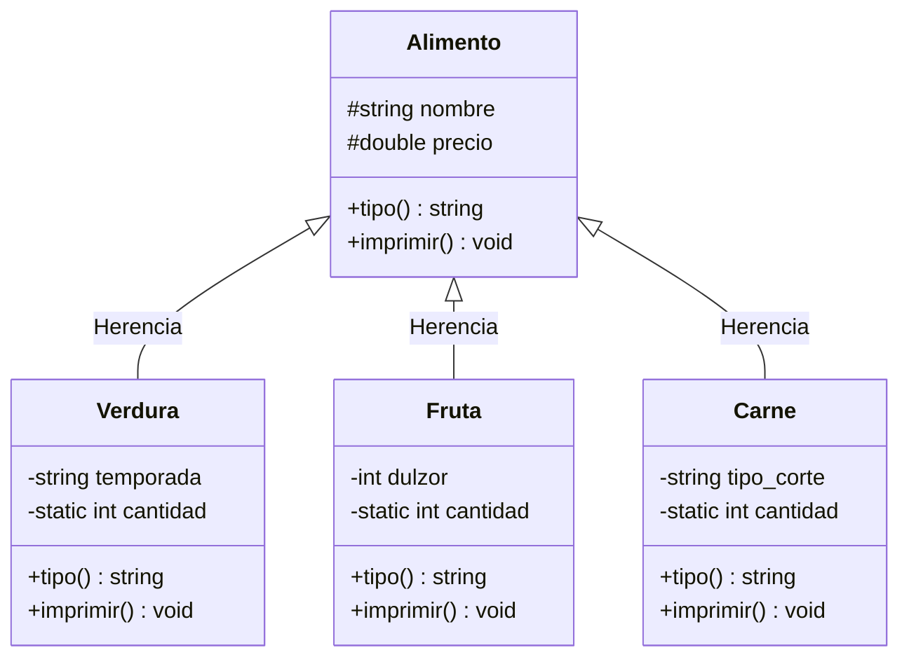

**Diagrama de flujo – recorrido del vector**

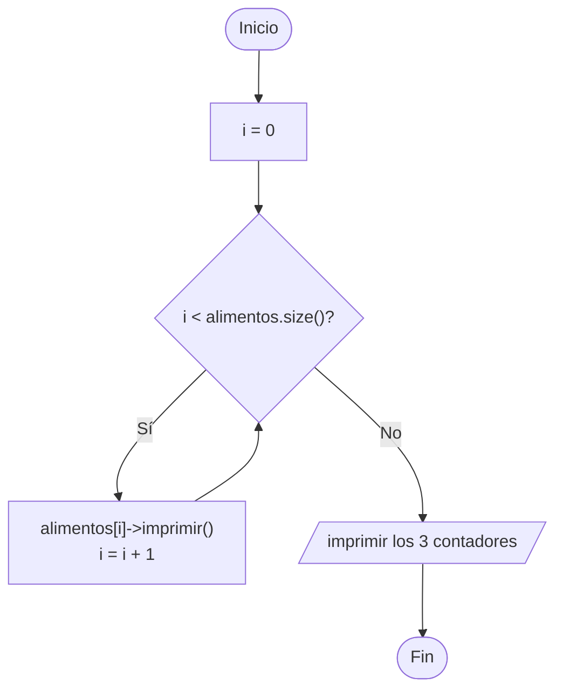

---

## 2. Verdura → reusar el método de la superclase

**Enunciado.** En `Verdura`, haga que `imprimir()` **llame primero** a la versión de la superclase con `Alimento::imprimir()` y luego agregue solo la línea de la temporada. Agregue además el método `virtual double precio_final() const` que en `Alimento` devuelve el precio tal cual y en `Verdura` le aplica un 10 % de descuento.

Compruebe en el `main` que `precio_final()` da distinto resultado según se llame por valor o por puntero.

**Conceptos:** operador de resolución de ámbito (`Superclase::metodo()`), reutilizar en vez de duplicar código, un método virtual con comportamiento por defecto en la superclase.

**Diagrama de clase**

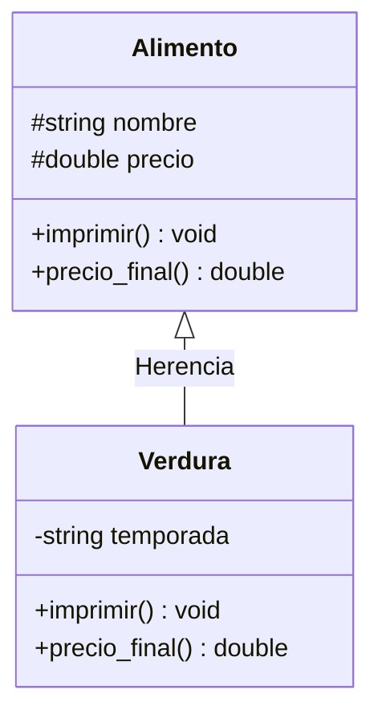

**Diagrama de flujo – `Verdura::imprimir()`**

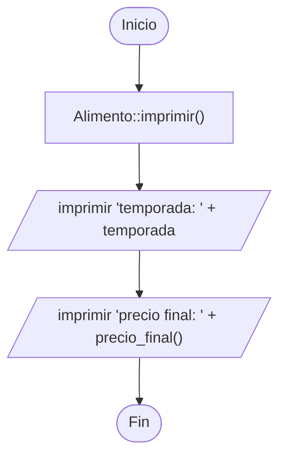

---

## 3. Animales → agregar un animal sin tocar el `main`

**Enunciado.** Con las clases de A3, agregue la clase `CVaca` (sonido `"Muuu"`, gana 0.80 por kilo, come solo verduras) y la clase `CSerpiente` (sonido `"Ssss"`, gana 0.50 por kilo, come solo carne).

La regla del ejercicio: **solo se puede agregar una línea por animal en el `main`** (el `push_back`). Ni el bucle de sonidos ni el de alimentación pueden cambiar.

**Conceptos:** extender una jerarquía sin modificar el código que la usa, implementar las funciones virtuales puras heredadas, por qué el `main` no necesita `if` por tipo de animal.

**Diagrama de clase**

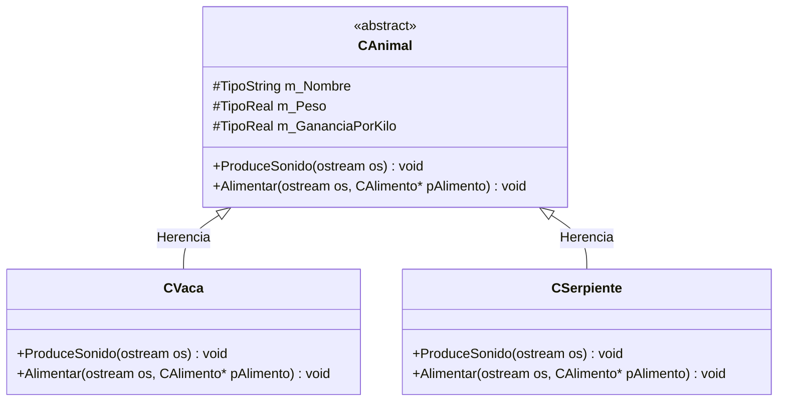

**Diagrama de flujo – `CVaca::Alimentar()`**

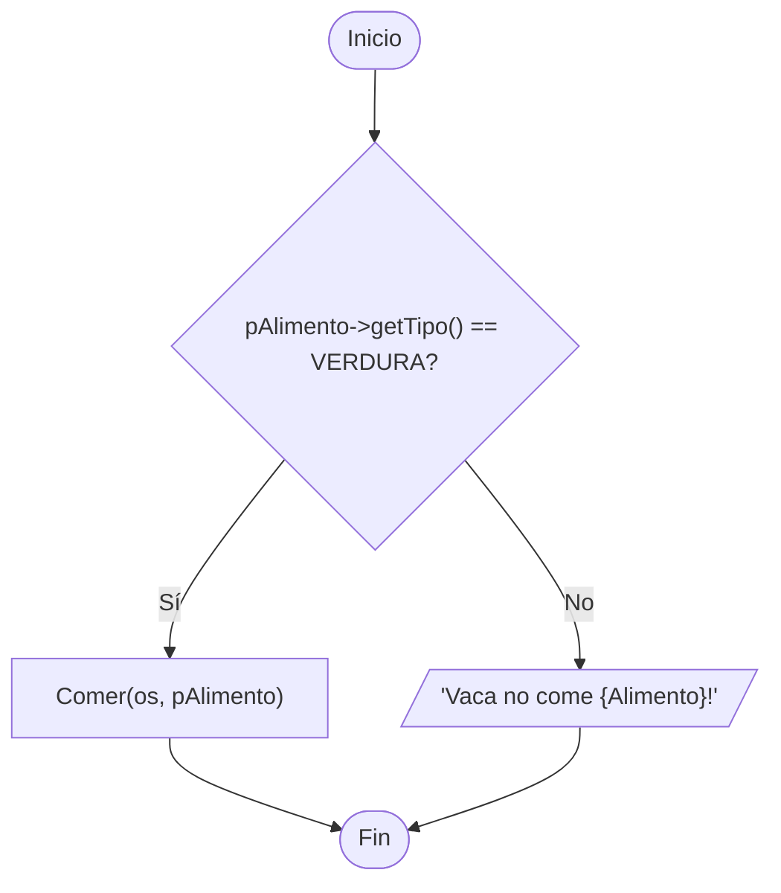

---

## 4. Animales → clase intermedia `CMamifero`

**Enunciado.** Inserte una clase intermedia `CMamifero` entre `CAnimal` y los mamíferos del ejercicio (`CRaton`, `CGato`, `CPerro`, `CTigre`). `CMamifero` agrega el atributo `m_Pelaje` y el método `virtual void Amamantar(std::ostream &os)`, que imprime un mensaje genérico.

`CGallina` sigue heredando directamente de `CAnimal`. En el `main` recorra el vector de `CAnimal*` y llame a `Amamantar()` **solo** en los que sean mamíferos (use un segundo vector de `CMamifero*`).

**Conceptos:** jerarquía de tres niveles, qué sube a la clase intermedia y qué se queda en la hoja, un objeto que pertenece a dos tipos a la vez (`CGato` es `CMamifero` y es `CAnimal`).

**Diagrama de clase**

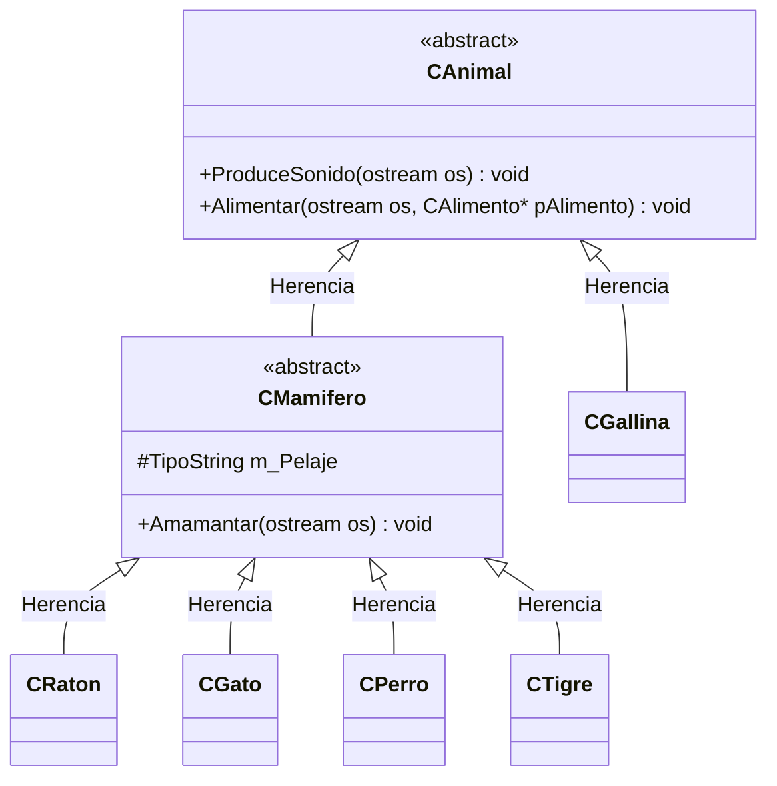

**Diagrama de flujo – constructor de `CGato`**

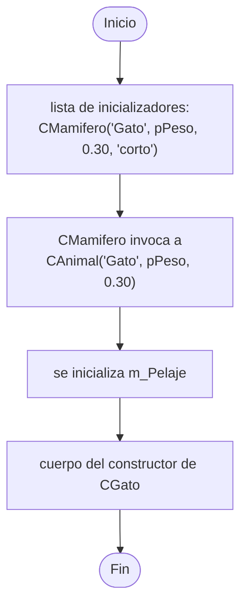

---

## 5. Animales → quién engordó más

**Enunciado.** Agregue a `CAnimal` los atributos `m_PesoInicial` y `m_KilosComidos`, actualizados dentro de `Comer()`, y los métodos `getPesoGanado()` y `getKilosComidos()`.

En el `main`, después de alimentar a todos los animales, imprima una tabla con nombre, peso inicial, peso final, kilos comidos y peso ganado, y luego el animal que **más peso ganó** y el que **más comida rechazó** (agregue también un contador de rechazos en `Rechazar()`).

**Conceptos:** agregar estado a la superclase para que lo hereden todas las subclases, recorrer un vector de punteros buscando el máximo, mantener coherente un contador dentro de un método heredado.

**Diagrama de clase**

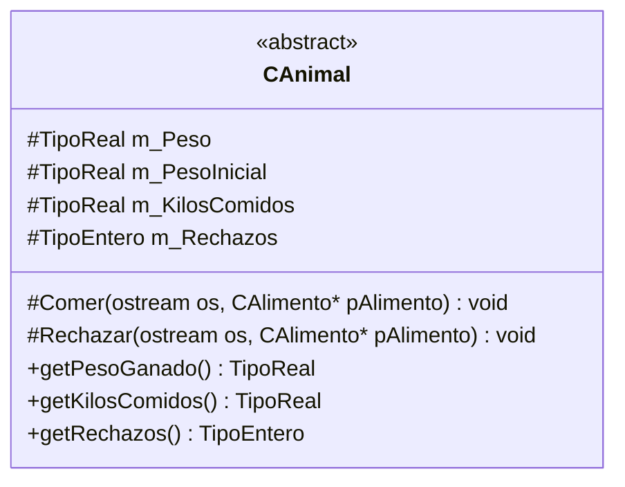

**Diagrama de flujo – animal que más peso ganó**

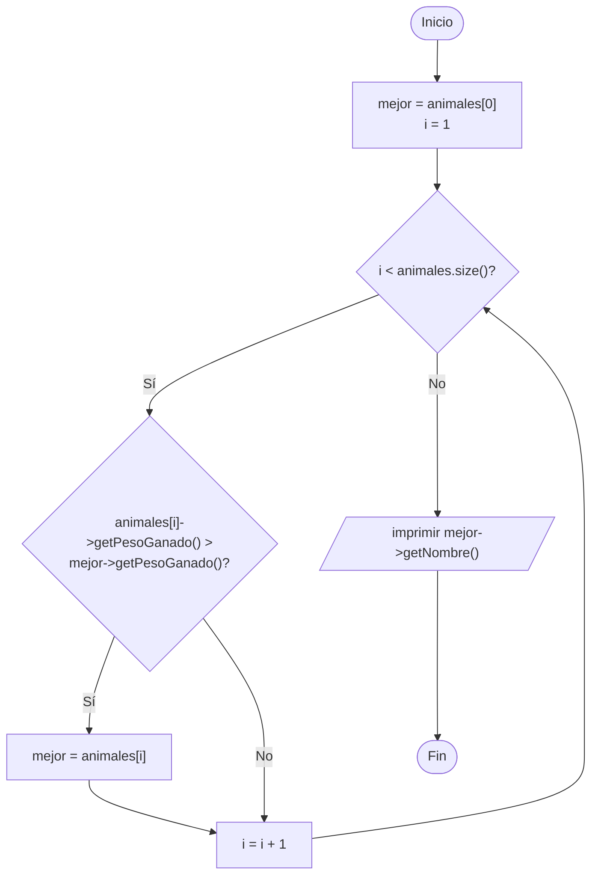

---

## 6. Gandalf → alimentos nuevos y descripción

**Enunciado.** Con las clases de B1, agregue las subclases `Vino` (+4 puntos) y `Pipa` (+6 puntos), y registre las dos en `FabricaAlimentos`. Agregue a `Alimento` el método `virtual std::string descripcion() const` que en la superclase devuelve `"comida cualquiera"` y en cada subclase una frase propia.

En el `main` imprima, por cada alimento comido, su nombre, su descripción y sus puntos.

**Conceptos:** extender una jerarquía y su fábrica, un segundo método virtual con valor por defecto en la superclase, que `Gandalf` **no cambie** al agregar alimentos.

**Diagrama de clase**

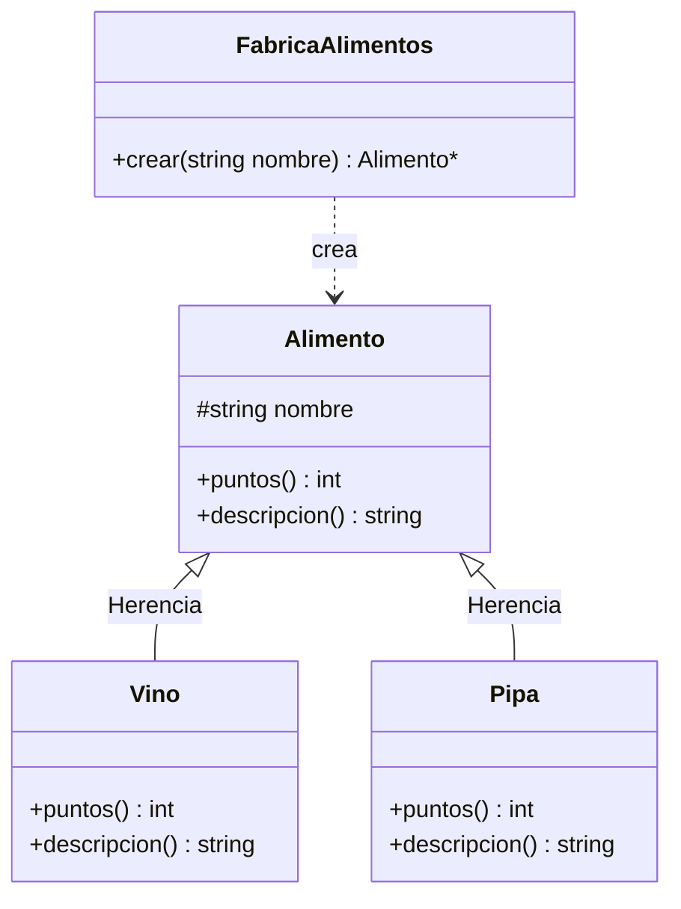

**Diagrama de flujo – `FabricaAlimentos::crear(nombre)`**

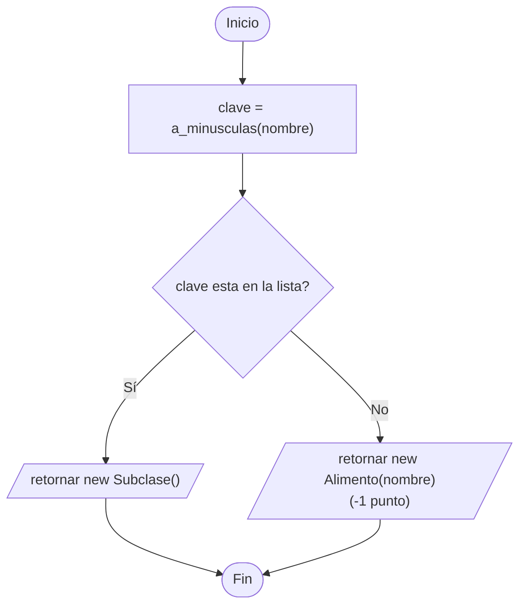

---

## 7. Gandalf → jerarquía de personajes

**Enunciado.** Cree la superclase `Personaje` con `nombre`, `puntos_felicidad`, el método `comer(Alimento*)` y el método `virtual std::string estado_animo() const`. Haga que `Gandalf` herede de `Personaje` manteniendo los rangos actuales, y agregue `Orco`, que hereda de `Personaje` pero con rangos distintos: `Furioso` por debajo de 0, `Conforme` de 0 a 10, `Satisfecho` por encima de 10. Para el orco, además, `Hongos` suma **+5** en vez de −10 (sobrescriba `comer()` o agregue un método virtual que ajuste los puntos).

En el `main` use un `vector<Personaje*>`, déle la misma lista de alimentos a los dos y compare los estados finales.

**Conceptos:** subir el comportamiento común a una superclase, sobrescribir la regla de negocio en cada subclase, el mismo mensaje con dos respuestas distintas.

**Diagrama de clase**

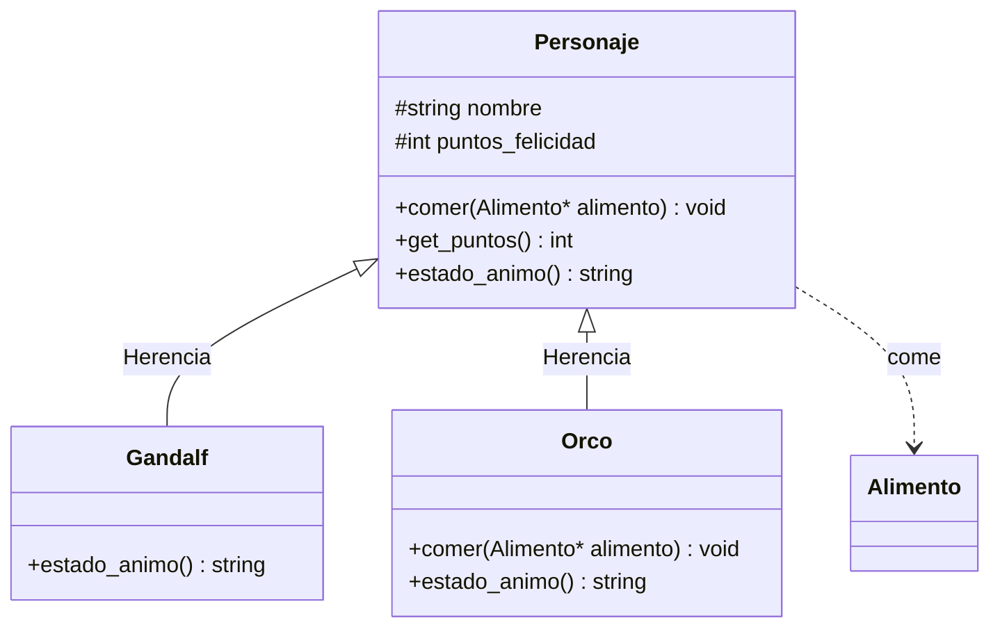

**Diagrama de flujo – `Orco::estado_animo()`**

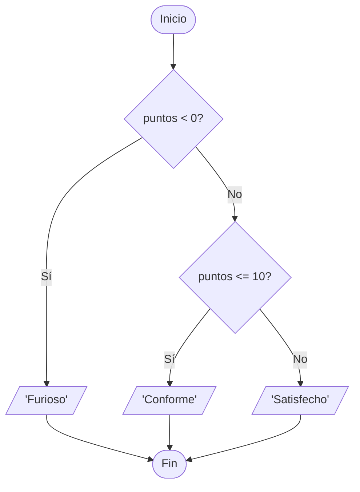

---

## 8. Herencia múltiple → el anfibio (reto)

**Enunciado.** Cree las clases abstractas `CAnimalTerrestre` (con `virtual void Caminar(std::ostream &os) = 0` y el atributo `m_CantidadPatas`) y `CAnimalAcuatico` (con `virtual void Nadar(std::ostream &os) = 0` y el atributo `m_ProfundidadMaxima`). Las dos tienen además el método `virtual void Moverse(std::ostream &os)`.

Cree la clase `CRana` que herede de **las dos** e implemente `Caminar()` y `Nadar()`. En el constructor invoque a los dos constructores de las superclases en la lista de inicializadores.

En el `main`:
- llame a `Caminar()` y `Nadar()` desde un objeto `CRana`,
- llame a `Moverse()` y observe el error de **ambigüedad**; resuélvalo con `rana.CAnimalTerrestre::Moverse(cout);`,
- guarde la misma rana en un `CAnimalTerrestre*` y en un `CAnimalAcuatico*`, y compruebe que los dos punteros funcionan.

**Conceptos:** herencia múltiple, orden de invocación de los constructores de las superclases, ambigüedad de un miembro con el mismo nombre en dos superclases y el operador de resolución de ámbito, un objeto visto desde dos tipos distintos.

**Diagrama de clase**

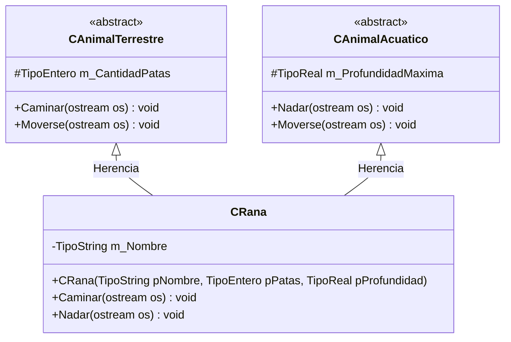

**Diagrama de flujo – constructor de `CRana`**

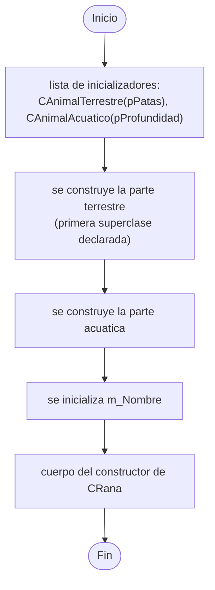

**Pregunta de cierre.** Si `CAnimalTerrestre` y `CAnimalAcuatico` heredaran a su vez de `CAnimal`, ¿cuántas copias de `m_Peso` tendría una `CRana`? ¿Cómo se evita?
