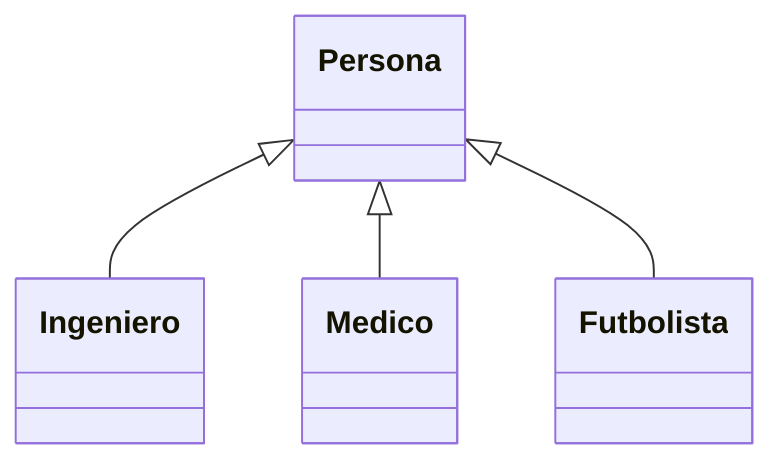
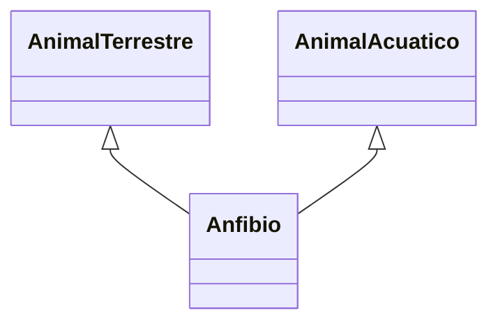

# PO_UTEC – Semana 12 (Herencia)

Laboratorio de **Programación II (CS6003)**, Unidad 6: *Relaciones entre clases*. Resumen de la teoría de la sesión 11 (**herencia, funciones virtuales, clases abstractas y herencia múltiple**) y de dónde se usa cada concepto en los ejercicios.

## Ejercicios del laboratorio

| Carpeta | Ejercicio | Concepto que usa |
|---------|-----------|------------------|
| `A1_ContinentePais` | Continente que contiene países, remover e imprimir poblaciones | agregación (repaso de la semana 11) |
| `A2_AlimentoVerdura` | Alimento y Verdura, contador de verduras compradas | herencia + `static` + métodos virtuales |
| `A3_Animales` | Animales que piden comida y se alimentan | clase abstracta + funciones virtuales **puras** |
| `B1_Gandalf` | Puntos de felicidad y estado de ánimo de Gandalf | herencia + polimorfismo (`puntos()` sobrescrito) |

Ejercicios adicionales: [EJERCICIOS_PROPUESTOS.md](EJERCICIOS_PROPUESTOS.md)

---

## 1. ¿Qué es la herencia?

La semana pasada las clases se **conocían** o se **contenían** (asociación, agregación, composición). La herencia es distinta: una clase **es** otra clase.

Una **subclase** (clase derivada o hija) hereda de una **superclase** (clase base o padre):

- hereda **todos** los atributos y métodos de la superclase,
- define **su propio** constructor,
- puede agregar atributos y métodos nuevos,
- puede **sobrescribir** los métodos heredados.

La herencia existe para **evitar la redundancia**: lo común se escribe una sola vez en la superclase.



---

## 2. La prueba del "es un"

Antes de usar herencia hay que poder decir la frase en voz alta:

- Un ingeniero **es una** persona ✔
- Una verdura **es un** alimento ✔
- Un tigre **es un** animal ✔
- Un auto **es un** vehículo ✔

Si la frase natural es *"tiene un"* y no *"es un"*, **no** es herencia: es agregación o composición.

| Frase | Relación |
|---|---|
| Un gato **es un** mamífero | herencia |
| Una universidad **tiene** alumnos | agregación |
| Un documento **tiene** capítulos (y mueren con él) | composición |
| Un cliente **conoce** su pedido | asociación |

En UML la herencia se dibuja con una **línea con un triángulo vacío** apuntando a la clase base.

---

## 3. Sintaxis

```cpp
class SubClase : nivel-de-acceso SuperClase {
    // ...
};
```

El nivel de acceso de la herencia puede ser `public`, `protected` o `private`. **En el curso se usa siempre `public`**: los miembros heredados conservan la visibilidad que tenían en la superclase.

```cpp
class Alimento {
private:
    int codigo;        // la subclase NO lo ve
protected:
    std::string nombre;  // la subclase SI lo ve, el main no
public:
    double precio;       // todos lo ven
};

class Verdura : public Alimento { ... };   // "una verdura es un alimento"
```

| Modificador | La propia clase | La subclase | El `main` |
|---|---|---|---|
| `private` | sí | **no** | no |
| `protected` | sí | **sí** | no |
| `public` | sí | sí | sí |

`protected` es el que aparece con la herencia: es el "privado, pero para la familia".

---

## 4. Constructores con herencia

Cuando se construye un objeto de la subclase, **primero se construye la parte de la superclase**.

```cpp
Verdura::Verdura(const string& nombre, double precio, const string& temporada)
        : Alimento(nombre, precio) {     // <- lista de inicializadores
    this->temporada = temporada;
}
```

- El constructor de la superclase se invoca en la **lista de inicializadores**, antes del cuerpo.
- Si no se lo invoca explícitamente, el compilador llama al **constructor por defecto** de la superclase (y si no existe, el programa no compila).
- Para usar un miembro de la superclase con el mismo nombre se usa el operador de resolución de ámbito: `Alimento::imprimir();`.
- **El constructor no puede ser virtual**: no se hereda. Cada subclase define el suyo.

---

## 5. Funciones virtuales

Un método `virtual` en la superclase se hereda a **todas** sus subclases y permite que, desde un puntero a la superclase, se ejecute la versión de la subclase.

```cpp
class Alimento {
public:
    virtual std::string tipo() const { return "Alimento"; }
    virtual ~Alimento();                       // destructor virtual
};

class Verdura : public Alimento {
public:
    std::string tipo() const override { return "Verdura"; }
};
```

```cpp
Alimento* p = new Verdura("Zanahoria", 3.2, "todo el anio");
p->tipo();        // "Verdura": se resuelve en TIEMPO DE EJECUCION

Alimento copia = verdura;
copia.tipo();     // "Alimento": la copia perdio la parte Verdura
```

Reglas prácticas:

- La función sobrescrita debe tener **la misma lista de parámetros**; se marca con `override` para que el compilador avise si no coincide.
- **El destructor debe ser `virtual`** en cualquier clase que se use como superclase con punteros, para que `delete` libere también la parte de la subclase.
- El **constructor no** puede ser virtual; las funciones **`friend` tampoco**, porque no son miembros y no se heredan.

El polimorfismo funciona con **punteros y referencias**, no con copias por valor.

**Se usa en:** A2 (`tipo()` e `imprimir()`), B1 (`puntos()`).

---

## 6. Funciones virtuales puras y clases abstractas

Una **función virtual pura** no tiene cuerpo: la implementación se deja a la subclase. Se marca con el **especificador puro** `= 0`.

```cpp
class CAnimal {
public:
    virtual void ProduceSonido(std::ostream &os) = 0;
    virtual void Alimentar(std::ostream &os, CAlimento* pAlimento) = 0;
    virtual ~CAnimal();
};
```

Una clase con una o más funciones virtuales puras es una **clase abstracta**:

- **no se puede instanciar** (`CAnimal a;` no compila), porque su definición está incompleta,
- solo sirve como superclase,
- para usarla hay que derivar una subclase e implementar **todas** sus funciones virtuales puras,
- esa subclase concreta ya sí se puede instanciar.

| | Función virtual | Función virtual pura |
|---|---|---|
| Tiene cuerpo en la superclase | sí | no (`= 0`) |
| La subclase está obligada a implementarla | no | **sí** |
| ¿La superclase se puede instanciar? | sí | **no** (es abstracta) |
| Para qué sirve | ofrecer un comportamiento por defecto | imponer un contrato |

**Se usa en:** A3 (`CAnimal` con `ProduceSonido` y `Alimentar`).

---

## 7. Herencia múltiple

C++ permite que una subclase herede de **más de una** superclase:

```cpp
class Anfibio : public AnimalTerrestre, public AnimalAcuatico { ... };
```



- El constructor invoca a **los dos** constructores en la lista de inicializadores, en el orden en que se declararon las superclases.
- Si las dos superclases tienen un miembro con el mismo nombre, hay **ambigüedad** y se resuelve con el operador de ámbito: `AnimalTerrestre::moverse()`.
- Si ambas heredan a su vez de una misma clase, esa clase aparece **dos veces** en el objeto (el "problema del diamante"); se evita con herencia virtual.

Se ve en la teoría de la sesión y se practica en los [ejercicios propuestos](EJERCICIOS_PROPUESTOS.md).

---

## 8. Errores frecuentes

- Usar herencia donde va composición: *un auto **tiene** un motor*, no *es un* motor.
- Olvidar el **destructor virtual** en la superclase: al hacer `delete` sobre un puntero a la superclase nunca se ejecuta el destructor de la subclase.
- Esperar polimorfismo en una **copia por valor** (`Alimento copia = verdura;`): se pierde la parte de la subclase y se llama al método de la superclase.
- Declarar los atributos `private` en la superclase y luego intentar usarlos en la subclase: para eso está `protected`.
- Asignar los valores heredados en el **cuerpo** del constructor en vez de invocar al constructor de la superclase en la lista de inicializadores.
- Cambiar la lista de parámetros al sobrescribir: ya no es un `override`, es una función nueva que **oculta** a la heredada. Marcar siempre `override`.
- Intentar instanciar una clase abstracta, u olvidar implementar una de sus funciones virtuales puras (la subclase sigue siendo abstracta).
- Definir el atributo `static` solo en el `.h`: hay que definirlo una vez en el `.cpp` (`int Verdura::cantidad = 0;`).

## Compilación

Cada carpeta es un proyecto CMake independiente (CLion). Ejecute siempre desde el botón ▶ del target del proyecto.
